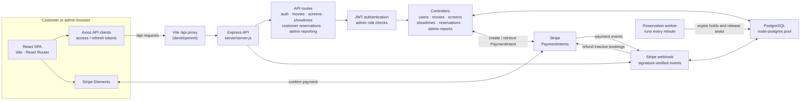
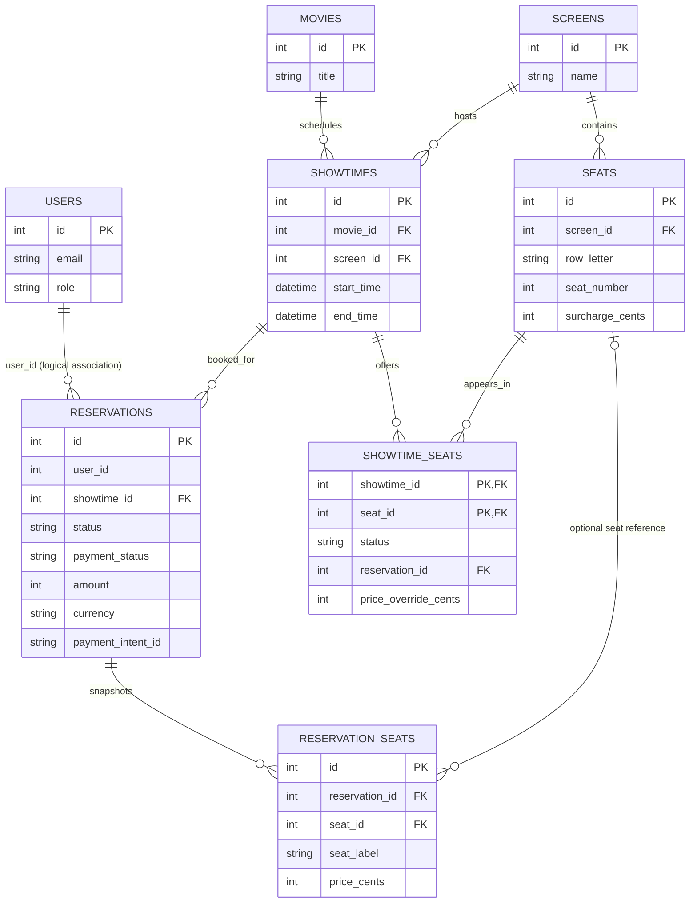

# Movie Reservation System — Project Diagram

## Application architecture



The Vite proxy is for local development. The Express API also serves the Stripe webhook at `/webhook` and mounts the JSON APIs under `/api`.

## Main data relationships



`RESERVATION_SEATS` preserves the seat label and price charged at booking time; its `seat_id` may be null if the original seat is deleted. `RESERVATIONS.user_id` associates a booking with a user in application logic; the migrations do not define it as a database foreign key.

## Seat booking and payment

```mermaid
sequenceDiagram
  actor Customer
  participant UI as React client
  participant API as Express API
  participant DB as PostgreSQL
  participant Stripe
  participant Worker as Expiration worker

  Customer->>UI: Select showtime and seats
  UI->>API: POST /api/reservations
  API->>DB: Lock available seats; create pending reservation and seat snapshots
  DB-->>API: Commit reservation and 10-minute seat hold
  API-->>UI: Reservation ID and total
  UI->>API: POST /api/reservations/create-payment-intent
  API->>Stripe: Create or retrieve PaymentIntent
  Stripe-->>API: Payment client secret
  API-->>UI: Payment client secret
  UI->>Stripe: Confirm payment with Stripe Elements
  Stripe-->>API: Signed payment_intent.succeeded webhook
  API->>DB: Mark reservation paid and confirmed; mark seats booked
  API-->>Stripe: Acknowledge webhook

  opt Payment succeeds after the hold expired or reservation was cancelled
    Worker->>DB: Expire old pending reservations and release held seats
    Stripe-->>API: Signed payment_intent.succeeded webhook
    API->>Stripe: Refund payment for inactive reservation
    API->>DB: Record refund status
  end
```
